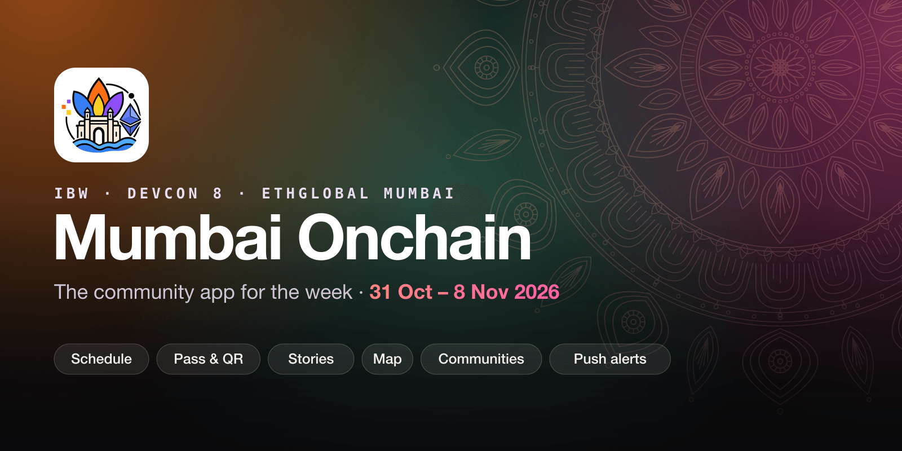

<p align="center">
  
</p>

<p align="center">
  <a href="https://www.mumbaionchain.site"></a>
  <a href="https://www.mumbaionchain.site/app"></a>
  <a href="https://x.com/Mumbai_onchain"></a>
</p>

<p align="center">
  
  
  
  
  
  
  <a href="LICENSE"></a>
  <a href="https://github.com/Najishanjum/mumbai-onchain/pulls"></a>
</p>

<p align="center">
  <a href="#whats-in-the-app">Features</a> ·
  <a href="#run-it-locally">Run it locally</a> ·
  <a href="#supabase">Supabase</a> ·
  <a href="#contributing">Contributing</a>
</p>

---

**Mumbai Onchain** is the community app for **India Blockchain Week, Devcon 8 and ETHGlobal Mumbai**: every event and side event in one schedule, a pass with a QR to meet people, stories from the week, and a map of Mumbai. It's free and installs from the browser, with no App Store.

It's one codebase with two faces:

- **Website**: the schedule, venues, the community partners page and the partner application.
- **App** (installed PWA, iPhone and Android): everything below. In a desktop browser, add `?app=1` to any URL to preview the app layout.

## What's in the app

**Today and Schedule**
- Every event and side event, with what's on now and what's next. Save events to your plan and swipe through the day's saved ones.
- A push **15 minutes before** a saved event starts, even with the app closed.
- **"I'm here"**: check in at an event that's on and see who's in the room. People you follow who are there get a push.

**People**
- Your **pass**: a badge with a QR, plus a lock-screen wallpaper and share images. Each badge has its own pattern, generated from the profile.
- Scan someone's pass to follow them. **Following / Followers**, Follow back, and a Message button that opens their Telegram or X.
- Stories that last **48 hours**, then stay as Highlights on the profile. You can see who viewed your story, and replies come to you privately.

**Communities**
- Partner communities each get a space: members, an **invite link** (`/app?c=<community>`) with QR, and a share card for X, Telegram and stories.
- Leaders are linked by the email they applied with, or with a one-use code from an admin or another leader.
- New people pick their community when making their pass (up to 3; the first one gets the credit).

**Map and Ask**
- MapLibre map of venues and places the community adds and rates (food, cafés, ATMs, SIMs). Admins approve new places.
- **Ask Mumbai**: an assistant for questions about the week and the city (Gemini).

**Admin mode** (Me → Switch to admin, for accounts in `app_admins`)
- **Events**: add an event from a Luma link, pick from a whole Luma calendar (e.g. `luma.com/ibw`), or add one by hand. Edit or hide any event, built-in ones included.
- **Places, Partners, Stories**: review and moderate. On partners you can set leaders, WhatsApp groups and logos.
- **Notify**: send a push to everyone.
- **Team** (owner only): add and remove admins.
- Admins get a push when another admin does something.

## Tech

| | |
|---|---|
| App | React 19, TypeScript, Vite 8, Tailwind CSS v4 |
| PWA | vite-plugin-pwa (Workbox), Web Push with VAPID |
| Map | MapLibre GL |
| Backend | Supabase: Postgres with row-level security, email-code sign-in, Storage, Edge Functions (Deno), pg_cron |
| Assistant | Gemini |
| Hosting | Vercel (`main` deploys to production) |

## Project layout

```text
src/
  app/            The installed app: screens (Today, Schedule, People, Me), sheets, admin/
  components/     The website
  lib/            Stores and hooks: people, events, communities, check-ins, push, PWA install
  data/           Built-in events (events.ts) and their covers
  types/
api/x/            Vercel function for X profile lookups (see docs/X_API_SETUP.md)
supabase/
  migrations/     Database changes, in date order
  functions/      Edge Functions (see below)
  cron/           Scheduled jobs
scripts/          Icons, event covers, sending a push from the terminal
public/           Icons, images, the push service worker
```

## Run it locally

Needs Node 20+.

```bash
npm install
cp .env.example .env.local   # then fill in the values
npm run dev                  # http://localhost:5173, add ?app=1 for the app
```

`.env.local`:

| Variable | What it's for |
|---|---|
| `VITE_SUPABASE_URL`, `VITE_SUPABASE_ANON_KEY` | Your Supabase project. Use a dev project, not production. |
| `VITE_GEMINI_API_KEY` | Ask Mumbai |
| `X_BEARER_TOKEN` | X profile lookups (server side only) |

Scripts:

| Command | Does |
|---|---|
| `npm run dev` | Dev server |
| `npm run build` | Type-check and build to `dist/` |
| `npm run preview` | Serve the build |
| `npm run lint` | Oxlint |
| `npm run icons` | Regenerate app icons |
| `npm run covers` | Fetch event cover images |
| `npm run transit` | Rebuild the metro and local train map data from OpenStreetMap |
| `npm run push -- "Title" "Body" [url]` | Send a push (needs `PUSH_ADMIN_SECRET` in `.env.local`) |

## Supabase

**Database.** Run the files in `supabase/migrations/` in date order, in the SQL Editor or with `supabase db push`. Each one is safe to re-run. `supabase/schema.sql` is the original base schema. Admins are rows in `app_admins` with the role `owner` or `admin`.

**Edge Functions:**

| Function | Does |
|---|---|
| `notify-connection` | Pushes for follows, story replies, check-ins, place and partner reviews, and admin activity |
| `send-push` | Push to everyone or chosen users (Admin → Notify, `npm run push`) |
| `event-reminders` | "Starts in 15 min" pushes for saved events. Deploy with `--no-verify-jwt`, then run `supabase/cron/event-reminders.sql` once |
| `event-import` | Reads a Luma event or calendar page for Admin → Events |

```bash
supabase functions deploy <name>
```

Function secrets (`supabase secrets set …`): `VAPID_PUBLIC_KEY`, `VAPID_PRIVATE_KEY`, `VAPID_SUBJECT`, `PUSH_ADMIN_SECRET`. Never commit them.

## Contributing

- Branch from `main` and open a pull request; `main` goes straight to production.
- Commit messages are one line, in the conventional style: `feat(app): …`, `fix(admin): …`, `docs: …`.
- Database changes go in a new dated file in `supabase/migrations/`. Say in the PR what to run before deploying.

## Team

- **Najish** ([@najish_anjum](https://x.com/najish_anjum)): Mumbai Onchain lead
- **Nimsara** ([@nimsaraonline](https://x.com/nimsaraonline)): built the app
- **Moinuddin** ([@md_moinuddin1](https://x.com/md_moinuddin1)): partnerships

## License

[MIT](LICENSE). Use it, fork it, build your own for your city's week.

Unofficial community app, not affiliated with the Ethereum Foundation, Devcon, IBW or ETHGlobal. Follow along on X at [@Mumbai_onchain](https://x.com/Mumbai_onchain).
